# N.O.V.A. System Architecture Specification

## 1. System Overview

Navigational Optical Verification & Authentication (**N.O.V.A.**) is an embedded engineering research prototype combining Near Field Communication (NFC), Visible Light Communication (VLC), and on-device neural network inference. The system demonstrates localized physical access control and autonomous optical alignment across two physically decoupled microcontrollers:

* **Subsystem 1 — VLC-Based Two-Factor Access Control (ESP32-S3):** Enforces a dual-verdict physical authentication gate requiring both a registered NFC credential and an optical key modulated at a role-specific frequency (10 Hz, 20 Hz, or 30 Hz).
* **Subsystem 2 — Autonomous Optical Docking (ESP32):** An autonomous optical tracking platform using a 28BYJ-48 unipolar stepper motor and a BPW34 PIN photodiode to locate the peak optical intensity vector across a $360^\circ$ sweep.

### 1.1 Architecture Status Matrix

| Architecture Domain | Implementation | Status | Engineering Rationale |
|:---|:---|:---:|:---|
| **Sampling Engine** | 100.0 Hz `esp_timer` ISR ($N=100$ samples) | **Frozen** | Maps target frequencies (10, 20, 30 Hz) to exact integer DFT bins ($k=10, 20, 30$) with zero theoretical spectral leakage. |
| **Authentication Gate** | Dual-verdict gate ($L_{\text{NFC}} \land \text{Conf}_{\text{ML}} \land M_{\text{Goertzel}}$) | **Frozen** | Prevents false unlocks by requiring agreement between probabilistic neural network inference and deterministic Goertzel DSP. |
| **Subsystem Decoupling** | Dual microcontroller hardware modules | **Frozen** | Isolates stepper motor inductive switching noise ($>300\text{ mA}$) from sensitive analog photodiode transimpedance amplification. |
| **Analog Front-End** | LM358 single-supply $+3.3\text{ V}$ TIA ($R_f=100\text{ k}\Omega$) | **Frozen** | Limits maximum op-amp output voltage to $\approx 1.8\text{ V}$, protecting the ESP32-S3 ADC pin against overvoltage damage. |
| **Edge Classifier** | Edge Impulse spectral analysis + 534-parameter Dense NN | **Experimental** | On-device inference verifying optical key waveforms; integer quantization evaluated for future builds. |
| **Inter-MCU Link** | Isolated UART / ESP-NOW cross-connect | **Proposed** | Reserved for future integration to allow Subsystem 1 to trigger Subsystem 2 alignment scans. |

---

## 2. System Block Diagram

```mermaid
graph TD
    subgraph SS1 ["Subsystem 1: Secure Access Control (ESP32-S3)"]
        A[MIFARE NFC Card] -->|13.56 MHz RFID| B[PN532 Reader I2C]
        B -->|Resolved Role| C[Auth State Machine FSM]
        D[Modulated Optical LED] -->|Free-Space Light| E[BPW34 PIN Photodiode]
        E -->|Photocurrent I_pd| F[LM358 TIA Rf=100k]
        F -->|Analog Voltage V_out| G[RC Filter fc=48.2 Hz]
        G -->|GPIO 1 ADC1_CH0| H[100 Hz esp_timer ISR]
        H -->|100 Float Samples| I[Dual-Verdict Verification]
        I -->|Spectral Features| J[Edge Impulse Classifier]
        I -->|Raw Buffer| K[Goertzel DFT k=10,20,30]
        J -->|ML Verdict >= 85%| L{Dual-Verdict 2FA Gate}
        K -->|DSP Dominance Ratio >= 2.0| L
        C --> L
        L -->|BOTH VERDICTS PASS| M[5V Relay Module]
        M -->|12V DC Pulse| N[Fail-Secure Solenoid Lock]
    end

    subgraph SS2 ["Subsystem 2: Autonomous Optical Docking (ESP32)"]
        O[Optical Beacon LED] -->|Free-Space Light| P[Docking BPW34 Sensor]
        P -->|ADC Read GPIO 34| Q[Alignment Controller]
        Q -->|8-Phase Half-Step Drive| R[ULN2003 Driver + 28BYJ-48 Stepper]
        R -->|Rotate Platform 360 deg| P
    end
```



---

## 3. Subsystem Specifications & Hardware Interfaces

### 3.1 Subsystem 1 — Secure Access Control (ESP32-S3)

* **Microcontroller:** ESP32-S3 DevKit-C (Xtensa dual-core LX7 @ 240 MHz, 16 MB Flash, 8 MB PSRAM).
* **Firmware Directory:** [`subsystem1_secure_access/`](../subsystem1_secure_access/)
* **Configuration Header:** [`subsystem1_secure_access/config.h`](../subsystem1_secure_access/config.h)

| Interface Aspect | Technical Specification |
|:---|:---|
| **NFC Interface** | PN532 module over I2C on GPIO 8 (SDA) and GPIO 9 (SCL) with external $10\text{ k}\Omega$ pull-ups. Reads 4-byte MIFARE Classic UIDs. |
| **Optical Analog Input** | BPW34 PIN photodiode feeding LM358 single-supply TIA ($R_f = 100\text{ k}\Omega$), followed by passive RC low-pass filter ($R = 3.3\text{ k}\Omega, C = 1.0\ \mu\text{F}, f_c = 48.2\text{ Hz}$) sampled on GPIO 1 (`ADC1_CH0`). |
| **Relay Control** | GPIO 4 driving active-HIGH optocoupled relay module. Asserts 12V DC to retract the solenoid lock for $5.0\text{ s}$ before auto-relock. |
| **Sampling Engine** | Hardware timer `esp_timer` triggers ADC reads at exactly $100.0\text{ Hz}$ ($T_s = 10.0\text{ ms}$) into a 100-sample circular buffer ($1.000\text{ s}$ observation window). |
| **DSP Core** | Fixed-point / float Goertzel filter evaluating DFT bins $k=10$ (10 Hz), $k=20$ (20 Hz), and $k=30$ (30 Hz). Enforces dominance ratio $\ge 2.0$. |
| **Edge ML Core** | Edge Impulse spectral analysis pipeline (13 features) feeding a 534-parameter fully connected classifier (`freq_10hz`, `freq_20hz`, `freq_30hz`, `noise`). Confidence threshold $\ge 0.85$. |
| **FSM States** | 8 non-blocking states: `IDLE`, `NFC_POLL`, `OPTICAL_PREP`, `OPTICAL_SAMPLE`, `VERIFY`, `UNLOCK`, `LOCKOUT`, `ERROR`. |

### 3.2 Subsystem 2 — Autonomous Optical Docking (ESP32)

* **Microcontroller:** ESP32 DevKit-V1 (ESP-WROOM-32 @ 240 MHz).
* **Firmware Directory:** [`subsystem2_docking/`](../subsystem2_docking/)
* **Configuration Header:** [`subsystem2_docking/config.h`](../subsystem2_docking/config.h)

| Interface Aspect | Technical Specification |
|:---|:---|
| **Optical Intensity Input** | BPW34 photodiode connected to GPIO 34 (`ADC1_CH6`, input-only pin). Oversampled 16x during coarse scan, 32x during fine scan. |
| **Motor Drive Interface** | ULN2003A Darlington driver inputs connected to GPIO 13 (IN1), GPIO 12 (IN2), GPIO 14 (IN3), GPIO 27 (IN4). |
| **Actuator** | 28BYJ-48 unipolar stepper motor with internal 1:64 reduction gearbox, operated in 8-phase half-step mode ($4096\text{ steps/rev}$, $0.08789^\circ/\text{step}$). |
| **Scanning Algorithm** | Two-phase scan: Coarse $360^\circ$ sweep (128 points, $2.8125^\circ$ spacing) followed by Fine sweep ($\pm 22.5^\circ$ around peak at 1-step resolution). |
| **Backlash Compensation** | 16 half-steps ($1.406^\circ$) CCW overshoot prior to final CW alignment approach. |
| **Power Management** | De-energizes all four motor coils (`stepper_release()`) once alignment completes, dropping idle power consumption to 0 mW while gearbox friction maintains mechanical alignment. |

### 3.3 Electrical & Physical Isolation Boundary

The two microcontrollers operate as independent hardware modules:
* Subsystem 1 and Subsystem 2 share no common control bus or interrupt lines.
* This physical separation eliminates stepper motor inductive switching transients ($>300\text{ mA}$ peak coil current) from interfering with Subsystem 1 photodiode analog front-end sampling.
* Inter-MCU communication (via optically isolated UART or ESP-NOW) is defined as a planned future extension.

---

## 4. Architecture Decision Records (ADRs)

Key architectural decisions and technical trade-offs are summarized below:

### ADR-001: Dual Microcontroller System Boundary
* **Decision:** Allocate Subsystem 1 (Access Control) to an ESP32-S3 and Subsystem 2 (Docking Stepper) to a separate ESP32 DevKit-V1.
* **Rationale:** Stepper motor switching transients induce ground bounce and supply ripple that degrade sensitive photodiode TIA measurements. Physical separation guarantees electrical isolation for microsecond-accurate ADC sampling.
* **Status:** Accepted.

### ADR-002: Dual-Verdict Authentication Gate (TinyML + Goertzel)
* **Decision:** Require simultaneous agreement between the Edge Impulse neural network classifier and the Goertzel DFT filter before asserting the relay unlock signal.
* **Rationale:** Neural network classifiers are probabilistic and can misclassify unfamiliar flicker waveforms. The Goertzel algorithm provides a deterministic mathematical verification of signal energy at target frequencies.
* **Status:** Accepted.

### ADR-003: Coherent Integer-Bin Frequency Alignment
* **Decision:** Fix sampling frequency to $f_s = 100.0\text{ Hz}$ and buffer length to $N = 100\text{ samples}$ ($1.000\text{ s}$ window).
* **Rationale:** Yields integer bin indices $k = \frac{f_{\text{target}}}{f_s} \cdot N \implies k_{10} = 10$, $k_{20} = 20$, $k_{30} = 30$, eliminating theoretical spectral leakage between channels without windowing overhead.
* **Status:** Accepted.

### ADR-004: 28BYJ-48 Stepper over Hobby Servo
* **Decision:** Use a geared 28BYJ-48 stepper motor with ULN2003 driver rather than a standard hobby servo.
* **Rationale:** 1:64 reduction gearbox provides fine discrete angular resolution ($0.08789^\circ/\text{step}$) across full $360^\circ$ continuous rotation, avoiding PWM pulse jitter and holding position mechanically when unpowered.
* **Status:** Accepted.

### ADR-005: Single 3.3V Supply for LM358 TIA
* **Decision:** Power the LM358 operational amplifier from the $+3.3\text{ V}$ logic supply rail rather than $+5.0\text{ V}$.
* **Rationale:** Operating the LM358 from $3.3\text{ V}$ constrains maximum output swing to $\approx 1.8\text{ V}$ ($V_{CC} - 1.5\text{ V}$), providing hardware-level overvoltage clamping that protects the ESP32-S3 ADC pin without external Zener diodes.
* **Status:** Accepted.

### ADR-006: Passive First-Order RC Anti-Aliasing Filter
* **Decision:** Place a passive RC low-pass filter ($R = 3.3\text{ k}\Omega, C = 1.0\ \mu\text{F}, f_c = 48.2\text{ Hz}$) between the TIA output and ADC input.
* **Rationale:** Enforces anti-aliasing cutoff below the $50.0\text{ Hz}$ Nyquist limit while attenuating $100\text{ Hz}$ fluorescent lighting flicker by $>14\text{ dB}$.
* **Status:** Accepted.

### ADR-007: Stepper Coil De-energization (`stepper_release`)
* **Decision:** Release all motor phases immediately after fine alignment completes.
* **Rationale:** Continuous holding current draws $>350\text{ mA}$, causing thermal dissipation in the ULN2003 driver. Gearbox detent friction holds platform alignment stably at 0 mW idle power.
* **Status:** Accepted.

### ADR-008: Non-Blocking State Machine Execution
* **Decision:** Structure firmware loops as non-blocking state machines ticked from Arduino `loop()`.
* **Rationale:** Ensures timer ISRs, NFC polling timeouts, and serial diagnostics execute without blocking delays, maintaining responsive fault handling.
* **Status:** Accepted.

---

## 5. Signal Flow & Data Processing Pipelines

### 5.1 Subsystem 1 Optical Signal Processing Chain

```text
[Modulated LED Beacon] (10 / 20 / 30 Hz square wave)
         │
         ▼ Free-Space Optical Transmission
[BPW34 PIN Photodiode] (Photocurrent I_pd, peak sensitivity 900 nm)
         │
         ▼
[LM358 Transimpedance Amplifier] (Gain Rf = 100 kΩ, single 3.3V rail)
         │
         ▼
[Passive RC Low-Pass Filter] (R = 3.3 kΩ, C = 1.0 µF, fc = 48.2 Hz)
         │
         ▼
[ESP32-S3 ADC1_CH0 / GPIO 1] (100 Hz esp_timer ISR, 100 float samples)
         │
         ├─────────────────────────────────────────┐
         ▼                                         ▼
[Goertzel Algorithm]                      [Edge Impulse TinyML]
- Compute magnitudes for k=10, 20, 30      - Extract 13 spectral features
- Dominance ratio = M_dom / max(M_other)   - 534-parameter Dense classifier
- Require Dominance Ratio >= 2.0           - Require Confidence >= 0.85
         │                                         │
         └────────────────────┬────────────────────┘
                              ▼
                 [Authentication FSM 2FA Gate]
                 - NFC UID matches registered role?
                 - Goertzel frequency matches role?
                 - TinyML class matches role?
                              │
                    {ALL THREE MUST MATCH}
                              │
                              ▼
                 [Assert GPIO 4 Unlock Pulse] (5.0 s hold)
```

---

## 6. Project Terminology

| Term | Definition | Context |
|:---|:---|:---|
| **N.O.V.A.** | Navigational Optical Verification & Authentication | System project name. |
| **VLC** | Visible Light Communication | Optical data transmission using modulated light. |
| **NFC** | Near Field Communication | $13.56\text{ MHz}$ RFID credential exchange (ISO/IEC 14443A). |
| **2FA** | Two-Factor Authentication | Requiring both NFC credential possession and matching VLC optical key. |
| **TIA** | Transimpedance Amplifier | Current-to-voltage amplifier circuit ($R_f = 100\text{ k}\Omega$). |
| **Goertzel Algorithm** | Second-order IIR filter evaluating discrete DFT bins | Deterministic DSP algorithm for detecting 10, 20, and 30 Hz tones. |
| **Dominance Ratio** | $\frac{M_{\text{dominant}}}{\max(M_{\text{other}})} \ge 2.0$ | Threshold ensuring spectral energy is concentrated in target bin. |
| **Backlash Compensation** | Mechanical overshoot routine | 16 half-steps CCW overshoot before CW alignment to remove gear play. |
