# N.O.V.A. Signal Processing Pipeline & Goertzel Derivation

## 1. Overview & Sampling Strategy

The Subsystem 1 optical signal processing engine decodes modulated Visible Light Communication (VLC) signals in real time on the ESP32-S3.

* **Sampling Rate ($f_s$):** $100.0\text{ Hz}$ ($T_s = 10.0\text{ ms}$, driven by hardware `esp_timer` ISR)
* **Sample Count ($N$):** $100\text{ samples}$ ($1.000\text{ s}$ observation window)
* **Frequency Bin Width ($\Delta f$):** $\frac{f_s}{N} = \frac{100.0\text{ Hz}}{100} = 1.0\text{ Hz}$
* **Nyquist Limit ($f_N$):** $\frac{f_s}{2} = 50.0\text{ Hz}$
* **Target Key Frequencies:**
  * Admin Key: $30.0\text{ Hz}$ ($k=30$)
  * Staff Key: $20.0\text{ Hz}$ ($k=20$)
  * Guest Key: $10.0\text{ Hz}$ ($k=10$)

Implementation references:
* Firmware DSP filter: [`subsystem1_secure_access/src/dsp/goertzel.cpp`](../subsystem1_secure_access/src/dsp/goertzel.cpp)
* Automated verification suite: [`validation/test_harnesses/test_goertzel.py`](../validation/test_harnesses/test_goertzel.py)

---

## 2. Complete Signal Chain

```mermaid
graph LR
    subgraph SG1 ["1. Optical Transmitter"]
        TX[LED Beacon Transmitter] -->|Modulated Light 10/20/30 Hz| CHAN[Free-Space Optical Channel]
    end

    subgraph SG2 ["2. Analog Front-End"]
        CHAN -->|Optical Flux E_e| PD[BPW34 PIN Photodiode]
        PD -->|Photocurrent I_pd| TIA[LM358 TIA Rf=100k]
        TIA -->|Analog Voltage V_out| LPF[RC Low-Pass Filter fc=48.2Hz]
    end

    subgraph SG3 ["3. Digital Sampling & Compute Core (ESP32-S3)"]
        LPF -->|Filtered Voltage 0-1.8V| ADC[ESP32-S3 ADC1_CH0 GPIO 1]
        ADC -->|100 Hz esp_timer ISR| BUF[100-Sample Buffer]
        
        BUF -->|100 Float Samples| DSP[Goertzel DFT k=10, 20, 30]
        BUF -->|Spectral Features| ML[Edge Impulse Classifier]
    end

    subgraph SG4 ["4. Decision & Physical Actuation"]
        DSP -->|DSP Dominant Freq & Ratio| GATE{Authentication FSM}
        ML -->|ML Confidence >= 85% & Class| GATE
        NFC[PN532 NFC Card Reader] -->|Scanned Card UID Role| GATE
        
        GATE -->|ALL VERDICTS MATCH ROLE| RELAY[5V Relay Module]
        RELAY -->|12V DC Actuation Pulse| LOCK[Fail-Secure Solenoid Lock]
    end
```

---

## 3. Goertzel Algorithm Mathematical Derivation

The Discrete Fourier Transform (DFT) at bin index $k$ for a discrete sequence $x[n]$ ($n = 0, 1, \dots, N-1$) is:

$$X[k] = \sum_{n=0}^{N-1} x[n] \cdot e^{-j \frac{2\pi}{N} k n}$$

The Goertzel algorithm computes this sum as a second-order Infinite Impulse Response (IIR) filter. The recurrence relation is:

$$s[n] = x[n] + 2 \cos(\omega_k) \cdot s[n-1] - s[n-2]$$

where $\omega_k = \frac{2\pi k}{N} = \frac{2\pi f_{\text{target}}}{f_s}$.

### Second-Order Recurrence Execution Steps
1. **Initialize state variables:** $s[-1] = 0$, $s[-2] = 0$.
2. **Precompute coefficient:** $\text{coeff} = 2 \cos\left(\frac{2\pi f_{\text{target}}}{f_s}\right)$.
3. **Iterate for each sample $n = 0 \dots N-1$:**
   $$s[0] = x[n] + \text{coeff} \cdot s[1] - s[2]$$
   $$s[2] = s[1]$$
   $$s[1] = s[0]$$
4. **Compute Magnitude Squared ($|X[k]|^2$):**
   $$|X[k]|^2 = s[1]^2 + s[2]^2 - \text{coeff} \cdot s[1] \cdot s[2]$$

### Computational Complexity Comparison ($N=100, K=3$)

| Algorithm | Multiplications | Additions | Total Operations | Memory Overhead | Execution Latency on ESP32-S3 |
|:---|:---:|:---:|:---:|:---:|:---:|
| **Goertzel ($K=3$)** | $N \cdot K + 2K = 306$ | $2N \cdot K + K = 603$ | **$\approx 900$ Ops** | **$O(1)$** (2 floats/bin) | **$< 0.8\text{ ms}$** |
| **Radix-2 FFT ($N=128$)** | $\frac{N}{2} \log_2 N = 448$ | $N \log_2 N = 896$ | $\approx 1344$ Ops | $O(N)$ buffer | $\approx 2.5\text{ ms}$ |
| **Full DFT ($N=100$)** | $N^2 \cdot K = 30,000$ | $N^2 \cdot K = 30,000$ | $60,000$ Ops | $O(N)$ buffer | $\approx 18.0\text{ ms}$ |

* **Memory:** Goertzel requires only two state variables per frequency bin, avoiding dynamic buffer allocations.
* **Latency:** Total execution across all three bins takes $<0.8\text{ ms}$ on the $240\text{ MHz}$ ESP32-S3, consuming $<0.08\%$ of the $1.000\text{ s}$ sampling period.

---

## 4. Coherent Sampling & Spectral Leakage Bounds

Spectral leakage occurs when an analyzed frequency does not fall exactly on an integer DFT bin index $k$.

### Theoretical Integer-Bin Alignment
With $f_s = 100.0\text{ Hz}$ and $N = 100$:
* $k_{10} = \frac{10.0}{100.0} \times 100 = 10$ (exact integer)
* $k_{20} = \frac{20.0}{100.0} \times 100 = 20$ (exact integer)
* $k_{30} = \frac{30.0}{100.0} \times 100 = 30$ (exact integer)

Under ideal conditions, the cross-channel leakage between these integer bins is mathematically zero.

### Real-World Leakage Bounds
In physical hardware, finite spectral leakage is introduced by:
1. Transmitter timer/crystal tolerances ($\pm 1.0\%\text{--}2.5\%$).
2. Sampling jitter from ISR scheduling latency ($\approx \pm 5\ \mu\text{s}$).
3. Square-wave harmonics and optical rise/fall times.

Testing with intentional frequency offsets up to $\pm 2.5\%$ (e.g., $29.25\text{ Hz}$ or $30.75\text{ Hz}$) shows that the target bin magnitude remains $> 4.8\times$ greater than adjacent bins. 

---

## 5. Dominance Ratio Thresholding Logic

To prevent broadband ambient noise or unmodulated static light from triggering false detections, the firmware evaluates the **Dominance Ratio**:

$$\text{Dominance Ratio} = \frac{M_{\text{highest}}}{\max(M_{\text{other}})} \ge 2.0$$

* If $\text{Dominance Ratio} \ge 2.0$: The highest frequency is marked as valid (`dominant_found = true`).
* If $\text{Dominance Ratio} < 2.0$: The signal is classified as ambiguous (`dominant_found = false`), blocking authentication (`AUTH_REASON_GOERTZEL_AMBIGUOUS`).
